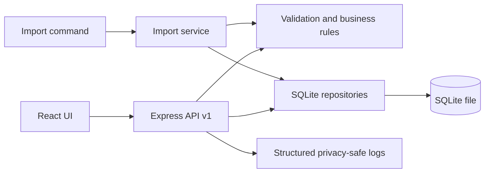

# 03 — Design

## System context and components

One local single-team deployment: React + Vite + TypeScript client communicates with Express/TypeScript REST API under `/api/v1`; API delegates to shared Zod validation, team-date/business services, repository layer and `better-sqlite3`. SQLite persists roster, standups, audit events and import jobs. A CLI reuses the same schemas/services for v1 import. Vite serves the client in development; production build is served by Express. No cloud services or external runtime dependencies.

## Data model

- `members(id TEXT PK, display_name TEXT, role TEXT, active INTEGER, configured INTEGER)`; role is `member`, `lead`, or `support` metadata only, not authorization. Configured roster is authoritative. On startup upsert configured identities, mark removed identities inactive, preserve prior IDs/history. Schema version 2 migrates earlier databases by adding `role` with a safe `member` default.
- `standups(id TEXT PK, member_id TEXT FK, team_date TEXT, tasks_json TEXT, blockers TEXT NOT NULL DEFAULT '', created_at_utc TEXT, updated_at_utc TEXT, UNIQUE(member_id,team_date))`. Optional blockers input normalizes to empty string.
- `audit_events(id TEXT PK, standup_id TEXT FK, event_type TEXT, timestamp_utc TEXT, previous_value_json TEXT, new_value_json TEXT)`; index by standup and timestamp.
- `import_jobs(id TEXT PK, file_name TEXT, file_sha256 TEXT UNIQUE, imported_at_utc TEXT, status TEXT, report_json TEXT)`.
- Index `standups(team_date, member_id)`, `standups(member_id, team_date)`, `audit_events(standup_id,timestamp_utc)`; SQLite WAL, foreign keys, busy timeout.

## Design alternatives

| Decision ID | Options | Trade-offs | Selection | Evidence |
|---|---|---|---|---|
| DEC-A | (A) check-then-insert; (B) unique `(member_id, team_date)` constraint and translate conflict | A is simple but races under concurrent calls; B makes invariant durable across API/import/concurrency. | B plus transaction for batch import; integration tests prove duplicate rejection, injected-failure rollback and reopen persistence. | RULE-02/REQ-F-10; related empirical test evidence exists; dedicated timed spike remains incomplete. |
| DEC-B | Store tasks as normalized child rows; JSON text column | Child rows enforce per-item constraints but require joins and more migration complexity; JSON preserves ordered task list and is appropriate at this scale. | JSON text, validated at boundary; unique/indexed scalar columns remain relational. | 10k expected rows; tests verify round-trip. |
| DEC-C | Timestamp-only audit; full before/after values | Timestamp-only minimizes copies; full values provide required change history but increase sensitive-data retention. | Full before/after JSON per DEC-04, no content logging, local trust caveat. | REQ-F-03/09, NFR-SEC/PRI. |

## Security privacy and trust boundaries

All API, UI and importer payloads are untrusted. Zod validation and parameterized SQLite statements protect input boundaries. React renders strings as text (no `dangerouslySetInnerHTML`); Markdown export escapes syntax and HTML-like delimiters. Imported content is never evaluated. Request/error logs include correlation ID, method, route, status, duration and safe error code only; no body, task, blocker, audit values or full import file. No auth or role-based authorization is implemented: roles are display metadata; bind to loopback and treat any network exposure as unsupported. Synthetic data only.

## Accessibility reliability and observability

Use semantic headings, nav/buttons/forms, associated labels, inline text errors and `aria-live` summary, visible focus ring, keyboard-operable navigation, responsive layout and status text independent of color. Log startup, requests, validation/storage/import outcomes as structured JSON; UUID correlation ID from middleware; preserve caller-provided correlation ID only after length/safe-character validation. Health probes DB. DB transactions protect update/audit atomicity and batch import. SQLite file is durable; shutdown closes handle; WAL checkpoint/backup documented. Restart and forced-failure tests required.

Correction UI: cards for either writable day activate the same controlled editor, set explicit member/date and move focus to tasks. Dashboard lookup determines POST versus PUT; the API remains authoritative for date/member validation. Request guard prevents duplicate saves; controls are disabled during submission. The returned saved record updates the dashboard before refresh, so a failed refresh cannot cause the next save to incorrectly POST a duplicate. Refresh preserves the selected writable date. Previous-day missing statuses are visible. Keep the complete roster for History's inactive-member filter, but derive the write selector/counts from active members only. History export passes its own calendar date and does not apply the member filter. Performance runner uses a temporary loopback Express server and consumes response JSON within each timed HTTP sample.

## Migration and recovery design

Strict version-1 JSON envelope `{version:1,standups:[...]}`. Each row resolves stable member ID, or exact case-normalized display name, then validates dates/tasks/blockers with shared schemas. Canonical `tasks` maps to the explicit `teamDate`/`date`; split legacy `today` maps to that date and `yesterday` maps to the previous working day (including Friday across weekends), yielding separate candidates. Task strings split on lines and strip common list prefixes; list tasks preserve order. Generic blockers apply to today and `yesterdayBlockers` to yesterday. The report distinguishes source `total` from expanded `standupCandidates`. Unknown names, invalid dates, missing fields and duplicates are per-row report items, not silently repaired. Markup-like text is plain text and safely escaped on display/export. First valid candidate per member/date wins. Existing DB row skips as conflict. Exact file SHA-256 is idempotent. Valid rows and ImportJob report commit in a single transaction; unexpected exception rolls back all. Retain input separately; never overwrite source. Recovery: stop app, copy SQLite DB plus WAL/SHM safely using SQLite backup API or quiesce/checkpoint, restore copy and verify health/counts. Supplied fixture-specific mapping still pending.

## Dependencies and risks

Runtime: Node.js, Express, better-sqlite3, Zod, React, Vite. Development/testing: TypeScript, Vitest, RTL, Supertest, ESLint, Prettier, secret-scan script and npm audit. Pin lockfile and use open-source packages. Main risks: native dependency on Windows, absent official fixtures, unauthenticated local trust model, and provisional v1 shape; see 01-planning.md R-01–R-05.

## AI interaction records

| ID/stage | Related IDs | Context and request | Suggestion | Human decision | Action and verification | Limitation/follow-up |
|---|---|---|---|---|---|---|
| AI-003 Design | REQ-F-01–10, RULE-01–08, NFR-* | Requirements/specification, one-team SQLite architecture; compare persistence, audit and import designs. | Database-enforced uniqueness, shared domain rules, atomic importer and safe output encoding. | Accept with qualification: spike and tests remain pending; no auth/fixture overclaim. | Design mapped to requirement IDs and later implementation/tests. | Must update design if implementation requires a specification change. |
